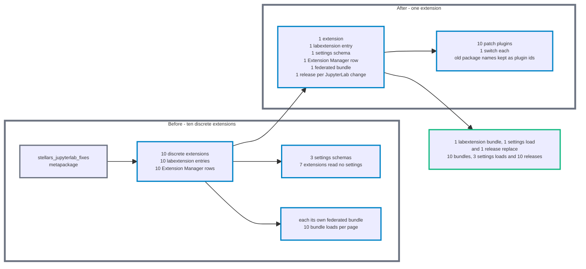

# jupyterlab_core_patches_extension

[](https://github.com/stellarshenson/jupyterlab_core_patches_extension/actions/workflows/build.yml)
[](https://www.npmjs.com/package/@stellarshenson/jupyterlab-core-patches-extension)
[](https://pypi.org/project/jupyterlab-core-patches-extension/)
[](https://pepy.tech/project/jupyterlab-core-patches-extension)
[](https://jupyterlab.readthedocs.io/en/stable/)
[](https://kolomolo.com)
[](https://www.paypal.com/donate/?hosted_button_id=B4KPBJDLLXTSA)

One JupyterLab 4 extension carrying ten core patches for the file browser, notebooks, Markdown and terminals.

Every patch has one switch in Settings, all on by default. A switch change applies on the next page reload.

> [!WARNING]
> Uninstall the bundle and the ten discrete packages before installing this one. Removing the bundle alone leaves the ten packages in place, and with both installed every patch runs twice.

## Replace the bundle and the discrete packages

```bash
pip uninstall stellars_jupyterlab_fixes
pip uninstall jupyterlab_change_ui_font_size_fix jupyterlab_file_browser_column_width_fix jupyterlab_jump_to_definition_fix jupyterlab_markdown_switch_tab_scrolling_fix jupyterlab_markdown_syntax_rendering_fix jupyterlab_markdown_viewer_toc_fix jupyterlab_other_file_type_menu_fix jupyterlab_restore_terminals_fix jupyterlab_server_proxy_launcher_fix jupyterlab_terminal_cpr_escape_fix
```

## Features

| Patch                                                           | Problem                                                                                                                                                   | How it solves it                                                                                                                                                   |
| --------------------------------------------------------------- | --------------------------------------------------------------------------------------------------------------------------------------------------------- | ------------------------------------------------------------------------------------------------------------------------------------------------------------------ |
| [UI font size alignment](docs/change-ui-font-size.md)           | File browser icons keep a fixed width while the item text follows the UI font size, so the text is not centered against its icon                          | Adds the `jp-core-patches-change-ui-font-size` body class and scopes CSS that sizes the icon from the UI font size and centers the text against it                 |
| [File browser column width](docs/file-browser-column-width.md)  | The file browser opens with collapsed columns after a saved 24 px layout or a sidebar resize                                                              | Wraps `DirListing.prototype._updateColumnSizes`, `_setColumnSize` and `_saveState` to replace a stale cached width and raise negative sizes to the column minimums |
| [Jump to definition](docs/jump-to-definition.md)                | Jump to definition in a Python notebook misses a package installed only in the kernel environment                                                         | Re-registers `lsp:jump-to-definition` so a Python notebook runs a Jedi analysis in the kernel, guarded once per application                                        |
| [Markdown tab scrolling](docs/markdown-switch-tab-scrolling.md) | A Markdown view loses its scroll position after a tab switch while its images load                                                                        | Connects to `ILabShell.currentChanged` to record the scroll position and restore it every 100 ms until the images settle                                           |
| [Markdown syntax rendering](docs/markdown-syntax-rendering.md)  | Rendered Markdown fenced code blocks show no syntax colours until a CodeMirror editor opens                                                               | Reads the rules from `jupyterHighlightStyle.module.getRules()` and injects them into one style element with a fixed id                                             |
| [Markdown viewer TOC](docs/markdown-viewer-toc.md)              | A table-of-contents entry or in-document anchor link does not move the Markdown Viewer to its heading                                                     | Wraps the renderer and viewer `setFragment` methods to resolve the anchor through `data-jupyter-id` and connects the TOC model to the heading elements             |
| [Other file type menu](docs/other-file-type-menu.md)            | The context menu on a file with no registered type repeats the previous widget's commands, and a file type with no mime types breaks the LSP context menu | Activates the right-clicked editor through a capture-phase `contextmenu` listener and gives every file type without mime types `text/plain`                        |
| [Restore terminals](docs/restore-terminals.md)                  | After a server restart, a restored terminal starts at the server root instead of its last folder                                                          | Reports open terminal names to the server, which stores each folder and re-creates the saved terminals before a browser connects                                   |
| [Server proxy launcher](docs/server-proxy-launcher.md)          | A server-proxy launcher in a custom category shows no icon                                                                                                | Fetches `/server-proxy/servers-info` once and wraps `app.commands.icon` to answer `server-proxy:open` from an icon cache                                           |
| [Terminal CPR escape](docs/terminal-cpr-escape.md)              | An idle terminal shows terminal query responses as literal text, and a terminal restored in a background tab replays its history at 80x24                 | Wraps `TermSocket.on_pty_read` and `TermSocket.open` to filter responses, strip queries from the replay and hold back the size of an unopened xterm                |

## Why one extension

This extension replaces the `stellars_jupyterlab_fixes` metapackage, which installed the same ten patches as ten discrete extensions. One extension loads one bundle in the browser instead of ten, and needs one release per JupyterLab change instead of ten.



The diagram shows ten discrete extensions consolidating into one extension: one labextension bundle and one settings load replace ten bundles and three settings loads, and one release per JupyterLab change replaces ten.

## Installation

Requires JupyterLab 4.6 or later.

```bash
pip install jupyterlab_core_patches_extension
```

## Uninstall

```bash
pip uninstall jupyterlab_core_patches_extension
```
